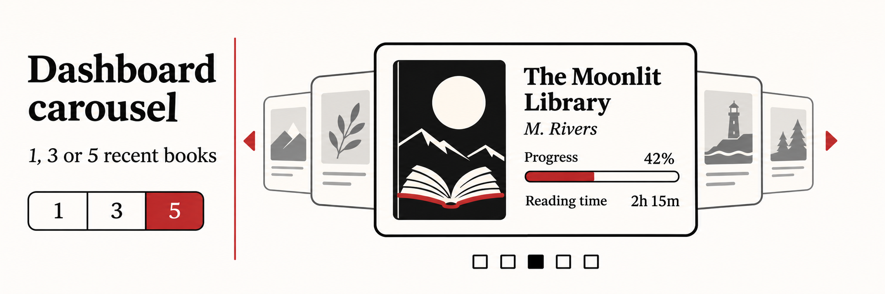

# Dashboard and Carousel

*Feature illustration.*

Select **Settings > Display > UI Theme > Dashboard** to use the Dashboard
home screen. In Portuguese, the theme is named **Painel**.

The Dashboard displays the selected book's cover, title, author, progress,
and available reading statistics. Device-wide information such as streak,
reader profile, Reserve Fuel, and books read remains in the footer according
to the enabled reading-stat settings.

## Number of Recent Books

While Dashboard is selected, **Settings > Display > Dashboard Books**
offers **1**, **3**, or **5**. The Portuguese label is **Livros no Dashboard**.

| Setting | Home behavior |
| --- | --- |
| **1** (default) | Show one recent book without carousel pagination. |
| **3** | Browse up to three recent books. |
| **5** | Browse up to five recent books. |

The limit applies to recent books that are still available on the SD card.
It does not add books to the reading history or create empty slots. For
example, four available recent books with the limit set to five produces
four page squares.

## Navigation

- Press the upper side button to select the previous book.
- Press the lower side button to select the next book.
- Navigation wraps from the last book to the first and back.
- The cover, progress, and reading statistics change together. The text
  beneath the title continues to show the author while navigating.
- The filled square indicates the selected book. Squares appear below the
  author, above the streak and reader-profile footer.
- **Read** opens the displayed book. Existing front-button menu shortcuts
  retain their actions.

If there are fewer recent books than the selected limit, only those books
are shown. The carousel needs at least two available books to change the
selection. Reading-stat values may be unavailable for books without tracking
data or formats that do not support those statistics.

## Existing Settings

Earlier test firmware offered an **Enable carousel** toggle. Updating from
that firmware preserves the choice: enabled becomes **3** books and disabled
becomes **1**. You can then select **5** in Display settings.

Changing the book limit does not reset reading progress or statistics. No
EPUB-cache reset is needed.
